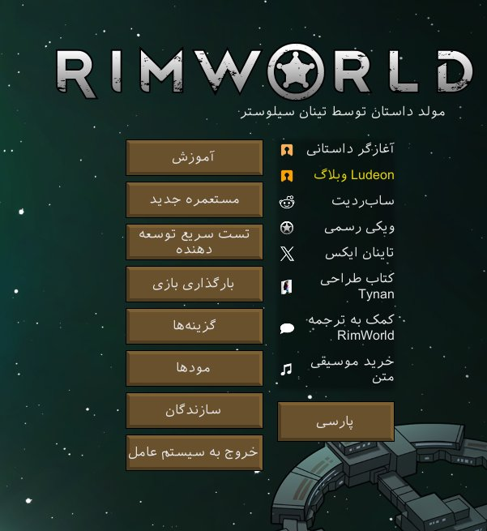

# RimWorld Farsi Translation

**[🌐 Official Documentation Portal (GitHub Pages)](https://Ludeon.github.io/RimWorld-Farsi/)** • **[مطالعه این راهنما به زبان فارسی (README_FA.md)](README_FA.md)**

---

The **official community Persian (فارسی) localization** for **RimWorld**, maintained in collaboration with **Ludeon Studios**. This repository provides full translation coverage, automated bidirectional text processing, and zero-friction 1-click installers for players and translators.

---

## 📚 Documentation & Guides Hub

Explore detailed documentation tailored to your needs:

| Guide | Description | Target Audience |
| :--- | :--- | :--- |
| 🌐 **[Documentation Portal (GitHub Pages)](https://Ludeon.github.io/RimWorld-Farsi/)** | Interactive Web Portal with live grammar playground, searchable lexicon, and install guides. | Everyone |
| 📜 **[PEP 2026: Roadmap & Architecture](docs/TODO.md)** | Strategic architectural specification, 10 implementation phases, and interactive task matrix. | Contributors & AI |
| 🌌 **[Universe Lore & Style Guide](docs/LORE_AND_STYLE_GUIDE.md)** | Canonical Persian translations for world types, Archotechs, factions, and narrative tones. | Writers & Translators |
| 📖 **[Translation Style Guide](docs/TRANSLATION_GUIDE.md)** | Persian typography (`ک`/`ی`), ZWNJ rules, format tokens (`{0}`), and official terminology glossary. | Translators & Reviewers |
| 🧠 **[Technical Challenges & Engine Architecture](docs/TECHNICAL_CHALLENGES.md)** | Why Unity IMGUI lacks text meshes, RTL shaping failures, and the dual-layer solution ([Ludeon #11](https://github.com/Ludeon/RimWorld-ar/issues/11)). | Developers & Modders |
| 🛠️ **[Developer Workflow & Tooling](docs/DEVELOPER_WORKFLOW.md)** | Setup with `uv`, pre-commit hooks, Ruff, Mypy, Pytest, and the `./tools/sync.sh` synchronization script. | Developers & Maintainers |
| 🤝 **[Contributing Guidelines](CONTRIBUTING.md)** | PR branching rules, commit standards, and step-by-step contribution paths. | Everyone |
| 🤖 **[AI Contributor Specification (AGENTS.md)](AGENTS.md)** | Strict behavioral and linguistic rulebook for AI assistants (Gemini, Claude, GPT). | AI & Tooling |

---

## ⚡ Quick Start: 1-Click Installation

### Method A: 1-File Auto-Installer (Recommended)

Download only the standalone installer for your OS from the [Latest Release](https://github.com/Ludeon/RimWorld-Farsi/releases/latest) — it verifies SHA-256 checksums automatically and lets you pick between **With RTL Mod (Recommended)**, **Essential**, or **Full**:

* **Windows:** Download and run `autoinstall-windows.bat` (or run [`install.bat`](install.bat) from a repository clone).
* **Linux / Steam Deck / macOS:** Download and run `autoinstall-linux.sh` (`chmod +x autoinstall-linux.sh && ./autoinstall-linux.sh`), or run `./install.sh` from a repository clone.

---

### Method B: Offline Release Packages & Manual Installation

1. Download your preferred OS-labeled archive from [Releases](https://github.com/Ludeon/RimWorld-Farsi/releases/latest):
   * `RimWorld-Farsi-With-RTL-Mod-<version>-windows.zip` / `-linux.zip` — Raw UTF-8 UI + English `Strings/` + `RTL_Persian_Support` mod (`Vazirmatn` font & UAX #9 BiDi engine)
   * `RimWorld-Farsi-Essential-<version>-windows.zip` / `-linux.zip` — Pre-shaped offline Persian UI + English `Strings/` (no mod required)
   * `RimWorld-Farsi-Full-<version>-windows.zip` / `-linux.zip` — Pre-shaped complete Persian translation (no mod required)
2. Extract the archive and run the bundled `install-windows.bat` or `./install-linux.sh`, **or** copy manually:
   * Copy each module folder (`Core`, `Royalty`, `Ideology`, `Biotech`, `Anomaly`, `Odyssey`) into `<RimWorld>/Data/<DLC>/Languages/Persian (فارسی)`.
   * If installing **With RTL Mod**, copy `mods/RTL_Persian_Support` into `<RimWorld>/Mods/RTL_Persian_Support` and enable it in the in-game **Mods** menu.
   * Delete any cached `Persian (فارسی).tar` file inside those `Languages/` folders so RimWorld reloads loose XML files.

---

## ⚙️ In-Game Activation

1. Launch **RimWorld**.
2. Click the **Options** menu (or the **Language Flag** icon).
3. Select **Persian (فارسی)** from the list. The UI reloads immediately.

> [!TIP]
> **100% Save Game Compatible**: Adding or removing this translation pack never alters game logic or breaks existing save files.

---

## 📦 Compatibility & DLC Support Matrix

| Expansion / DLC | Status | Repository Path | Target Game Directory |
| :--- | :---: | :---: | :--- |
| **RimWorld Core** | Supported | `Core/` | `<RimWorld>/Data/Core/Languages/Persian (فارسی)` |
| **Royalty DLC** | Supported | `Royalty/` | `<RimWorld>/Data/Royalty/Languages/Persian (فارسی)` |
| **Ideology DLC** | Supported | `Ideology/` | `<RimWorld>/Data/Ideology/Languages/Persian (فارسی)` |
| **Biotech DLC** | Supported | `Biotech/` | `<RimWorld>/Data/Biotech/Languages/Persian (فارسی)` |
| **Anomaly DLC** | Supported | `Anomaly/` | `<RimWorld>/Data/Anomaly/Languages/Persian (فارسی)` |
| **Odyssey** | Supported | `Odyssey/` | `<RimWorld>/Data/Odyssey/Languages/Persian (فارسی)` |

---

## 🖼️ In-Game Preview

  

---

## 🧩 Architectural Highlights & RTL Engine

RimWorld's UI is built on **Unity IMGUI**, which lacks text meshes and native complex text layout engines:

> *"RimWorld uses IMGUI. There are no text meshes."* — **Tynan Sylvester** ([Ludeon/RimWorld-ar#11](https://github.com/Ludeon/RimWorld-ar/issues/11))

To overcome disconnected letters (`پ ا ر س ی` vs `پارسی`) and inverted reading orders, this repository employs a **dual-layer architecture**:
1. **Static XML Presentation Forms Preprocessor (`tools/rtl-processor/`)**: Converts characters into Unicode Arabic Presentation Forms-B and inverts word order for pure vanilla compatibility without mod requirements.
2. **Runtime Harmony Patch (`mods/RTL_Persian_Support/`)**: Intercepts `Verse.Text` and `Widgets` IMGUI routines with a UAX #9 BiDi reorderer, width-aware wrapping (`FixForWidth`), and custom typeface injection (`Vazirmatn.ttf` default, `IranianSans.ttf` fallback).

For a deep technical analysis, see **[docs/TECHNICAL_CHALLENGES.md](docs/TECHNICAL_CHALLENGES.md)**.

---

## 🚫 Kept in English for Stability

To maintain mod compatibility and prevent gameplay bugs:
- **Preset character names and faction titles**: Untranslated where RimWorld lacks internal localization keys.
- **Developer Mode & Debug Logs**: Kept in original English for technical troubleshooting.
- **Keybinding Identifiers**: Retained to match physical keyboards.
- **Original Credits**: Preserved to honor the game's creators.
- **English Reference (`src/english/`)**: Original English game language files are mirrored under `src/english/` for upstream diffing and translation tooling (`tools/translation-tools/check_upstream_diff.py`).

---

## 🏆 Contributors & Acknowledgements

### Maintainer & Lead Translator
* **Danial Pahlavan** ([@DanialPahlavan](https://github.com/DanialPahlavan))

### Past Contributors
* **Seyed Abdollahi** ([@SeyedAbdollahi](https://github.com/SeyedAbdollahi))

### Acknowledgements
* **Ludeon Studios** for creating RimWorld and supporting community localizations.
* **@mtimoustafa** & **@asidsx** for pioneering Arabic RTL shaping work in RimWorld ([Ludeon/RimWorld-ar#13](https://github.com/Ludeon/RimWorld-ar/issues/13)).

---

## 📜 License

This project is licensed under the **GNU General Public License v3.0**. See the [LICENSE](LICENSE) file for details.
