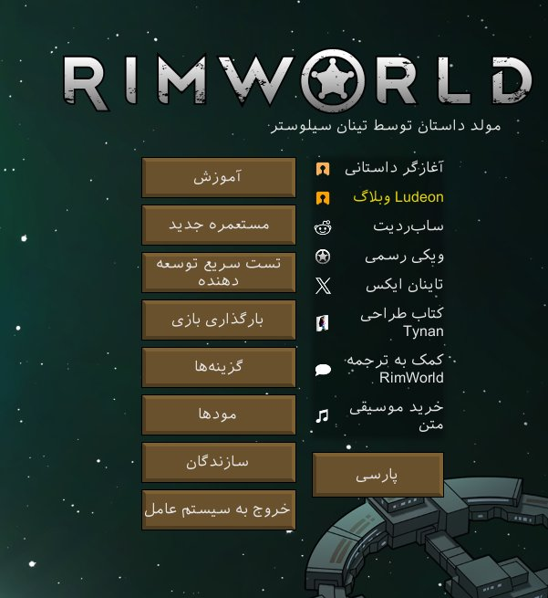

# ترجمه فارسی رسمی بازی RimWorld

**[English Documentation (README.md)](README.md)** • **[پورتال آنلاین مستندات](https://Ludeon.github.io/RimWorld-Farsi/)**

---

این مخزن شامل **بسته رسمی ترجمه فارسی بازی RimWorld** است که با پشتیبانی استودیوی **Ludeon** ایجاد شده و توسط جامعه بازیکنان و مترجمان فارسی‌زبان به‌طور مداوم نگهداری و توسعه داده می‌شود.

---

## مرکز راهنماها و مستندات پروژه

| راهنما | توضیحات | مخاطب |
| :--- | :--- | :--- |
| **[پورتال مستندات (GitHub Pages)](https://Ludeon.github.io/RimWorld-Farsi/)** | پایگاه تعاملی با زمین‌بازی گرامر، واژه‌نامه قابل جست‌وجو و راهنمای نصب. | همگان |
| **[سند نقشه راه PEP 2026](docs/TODO.md)** | معماری راهبردی پروژه و ماتریس کامل فازهای اجرا. | مشارکت‌کنندگان |
| **[راهنمای جهان داستانی و لحن](docs/LORE_AND_STYLE_GUIDE.md)** | واژه‌گذاری رسمی دنیاهای بازی، آرکوتک‌ها، جناح‌ها و لحن متن‌ها. | مترجمان و نویسندگان |
| **[راهنمای شیوه‌نامه ترجمه](docs/TRANSLATION_GUIDE.md)** | اصول حروف‌چینی فارسی، نیم‌فاصله، متغیرها و واژه‌نامه تخصصی. | مترجمان و بازبین‌ها |
| **[چالش‌های فنی و موتور بازی](docs/TECHNICAL_CHALLENGES.md)** | محدودیت‌های Unity IMGUI، رندرینگ راست‌به‌چپ و معماری دولایه. | توسعه‌دهندگان |
| **[گردش کار توسعه و ابزارها](docs/DEVELOPER_WORKFLOW.md)** | راه‌اندازی محیط پایتون، Ruff، Mypy، Pytest و `run_qa.py`. | توسعه‌دهندگان |
| **[راهنمای مشارکت](CONTRIBUTING.md)** | قواعد شاخه‌بندی گیت، استاندارد کامیت و ارسال Pull Request. | همگان |
| **[مشخصات عامل‌های هوش مصنوعی](AGENTS.md)** | قوانین زبانی و کیفیت کد برای مشارکت‌کنندگان انسانی و AI. | توسعه‌دهندگان و AI |

---

## نصب آسان و سریع

### روش ۱: نصب‌کننده تک‌فایل خودکار (پیشنهادی)

تنها فایل نصب‌کننده سیستم‌عامل خود را از [صفحه آخرین انتشار](https://github.com/Ludeon/RimWorld-Farsi/releases/latest) دریافت و اجرا کنید. اسکریپت پس از دریافت بسته مناسب و تایید هش SHA-256، امکان انتخاب بین ۳ نسخه را فراهم می‌کند:

- **ویندوز:** دریافت و اجرای `autoinstall-windows.bat` (یا اجرای `install.bat` در مخزن کلون‌شده).
- **لینوکس، استیم‌دک و مک:** دریافت و اجرای `autoinstall-linux.sh` با دستور زیر:
  `chmod +x autoinstall-linux.sh && ./autoinstall-linux.sh`

---

### روش ۲: بسته‌های آفلاین و نصب دستی

۱. آرشیو متناسب با سیستم‌عامل و نسخه دلخواه خود را از [Releases](https://github.com/Ludeon/RimWorld-Farsi/releases/latest) دریافت کنید:
- `RimWorld-Farsi-With-RTL-Mod-<version>-windows.zip` / `-linux.zip` — متن فارسی خام UTF-8 + پوشه `Strings/` انگلیسی + ماد `RTL_Persian_Support` با فونت وزیرمتن و موتور BiDi
- `RimWorld-Farsi-Essential-<version>-windows.zip` / `-linux.zip` — نسخه پیش‌پردازش‌شده آفلاین برای منوها + `Strings/` انگلیسی (بدون نیاز به ماد)
- `RimWorld-Farsi-Full-<version>-windows.zip` / `-linux.zip` — ترجمه کامل پیش‌پردازش‌شده (بدون نیاز به ماد)

۲. فایل فشرده را استخراج کرده و `install-windows.bat` یا `./install-linux.sh` را اجرا کنید، یا هر ماژول (`Core`, `Royalty`, `Ideology`, `Biotech`, `Anomaly`, `Odyssey`) را به مسیر زیر منتقل نمایید:  
`<RimWorld>/Data/<DLC>/Languages/Persian (فارسی)`

۳. در نسخه همراه با ماد، پوشه `mods/RTL_Persian_Support` را در `<RimWorld>/Mods/RTL_Persian_Support` کپی کرده و در منوی **Mods** بازی فعال نمایید؛ همچنین فایل‌های کش `Persian (فارسی).tar` موجود در پوشه `Languages/` را پاک کنید.

---

## فعال‌سازی درون بازی

۱. بازی **RimWorld** را اجرا کنید.
۲. در منوی اصلی، وارد **Options** شوید یا روی آیکون **پرچم زبان** کلیک کنید.
۳. زبان **Persian (فارسی)** را انتخاب کنید؛ در صورت استفاده از نسخه ماد، در منوی **Mods** ماد `RTL Persian Support` را نیز فعال نمایید.

> [!TIP]
> **سازگاری ۱۰۰٪ با فایل‌های ذخیره (Save Game):** نصب یا حذف این بسته زبان هیچ تغییری در منطق گیم‌پلی ایجاد نمی‌کند و به سیوهای قبلی آسیب نمی‌رساند.

---

## جدول سازگاری و وضعیت بسته‌های الحاقی

| بسته الحاقی | وضعیت | مسیر در مخزن | مسیر مقصد در بازی |
| :--- | :---: | :---: | :--- |
| **RimWorld Core (پایه)** | پشتیبانی کامل | `Core/` | `<RimWorld>/Data/Core/Languages/Persian (فارسی)` |
| **Royalty DLC** | پشتیبانی کامل | `Royalty/` | `<RimWorld>/Data/Royalty/Languages/Persian (فارسی)` |
| **Ideology DLC** | پشتیبانی کامل | `Ideology/` | `<RimWorld>/Data/Ideology/Languages/Persian (فارسی)` |
| **Biotech DLC** | پشتیبانی کامل | `Biotech/` | `<RimWorld>/Data/Biotech/Languages/Persian (فارسی)` |
| **Anomaly DLC** | پشتیبانی کامل | `Anomaly/` | `<RimWorld>/Data/Anomaly/Languages/Persian (فارسی)` |
| **Odyssey** | پشتیبانی کامل | `Odyssey/` | `<RimWorld>/Data/Odyssey/Languages/Persian (فارسی)` |

---

## پیش‌نمایش محیط بازی

  

---

## نکات معماری و موتور راست‌به‌چپ

رابط کاربری ریم‌ورلد روی **Unity IMGUI** بنا شده و فاقد پشتیبانی بومی از چیدمان راست‌به‌چپ و اتصال حروف است. پروژه برای حل کامل این موضوع از **معماری دولایه** استفاده می‌کند:
۱. **پیش‌پردازش استاتیک فرم‌های یونی‌کد (`tools/rtl-processor/`):** تبدیل متون خام به اشکال متصل و ترتیب نمایشی برای اجرای بدون ماد.
۲. **ماد زمان اجرا هارمونی (`mods/RTL_Persian_Support/`):** پردازش بلادرنگ با الگوریتم استاندارد `UAX #9`، شکستن صحیح سطرها (`FixForWidth`) و تزریق قلم **وزیرمتن (`Vazirmatn.ttf`)** به عنوان فونت پیش‌فرض (و `IranianSans.ttf` به عنوان گزینه کلاسیک).

جزئیات فنی بیشتر در **[docs/TECHNICAL_CHALLENGES.md](docs/TECHNICAL_CHALLENGES.md)** موجود است.

---

## مشارکت‌کنندگان و پروانه

- **نگهدارنده و مترجم اصلی:** دانیال پهلوان ([@DanialPahlavan](https://github.com/DanialPahlavan))
- **مشارکت‌کنندگان پیشین:** سید عبداللهی ([@SeyedAbdollahi](https://github.com/SeyedAbdollahi))
- **قدردانی:** استودیوی Ludeon و پیشگامان ابزارهای RTL در پروژه عربی ([@mtimoustafa](https://github.com/mtimoustafa) و [@asidsx](https://github.com/asidsx)).

این پروژه تحت مجوز **GNU General Public License v3.0** منتشر شده است ([LICENSE](LICENSE)).

